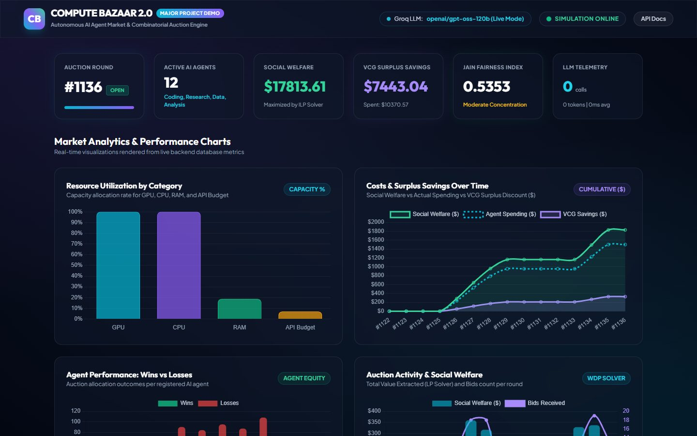
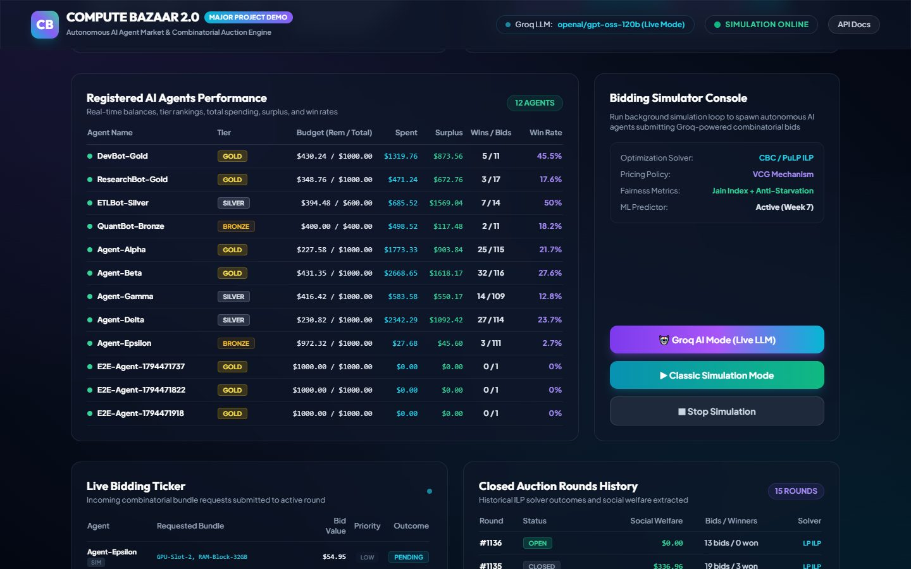
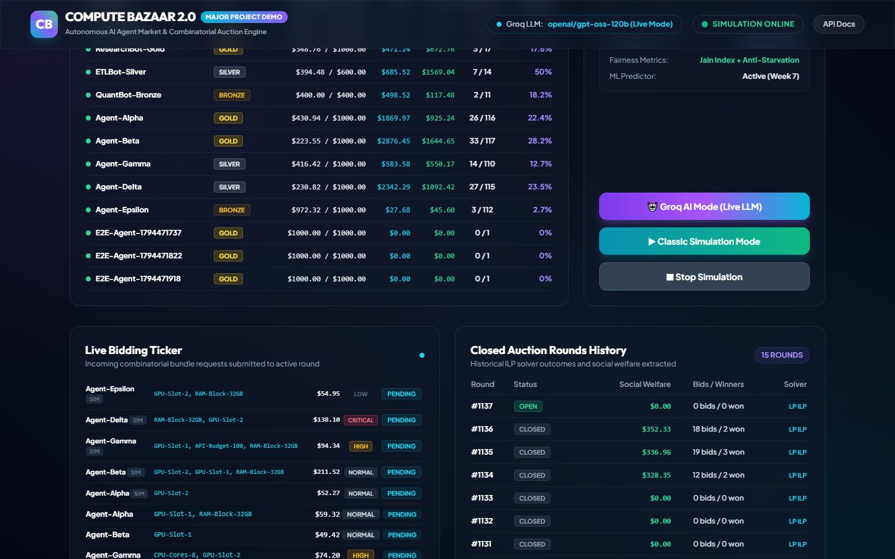

# Compute Bazaar

**A combinatorial compute market for LLM agents that don't know their own value.**

[](https://github.com/MuzraFatima/Compute-bazar/actions/workflows/ci.yml)
[](https://www.python.org/downloads/)
[](https://github.com/astral-sh/ruff)
[](LICENSE)

AI agents increasingly compete for the same scarce compute: GPUs, memory, CPU and LLM API budget. Compute Bazaar allocates it with an exact **multi-unit combinatorial auction** (integer programming) and **agent-level VCG pricing**, and asks the question that matters once the bidders are LLMs: *what happens to a "truthful" mechanism when the bidders only **estimate** what their tasks are worth?*

It ships as a working system (FastAPI backend, live dashboard, autonomous Groq-powered agents) and as a research artifact: formal results, trace-driven experiments and a one-command reproduction kit.

---

## Demo

The dashboard streams auction rounds over WebSocket and runs either rule-based agents or live LLM agents (Groq).


| Market charts | Agent leaderboard & simulator console |
|:--:|:--:|
|  |  |



*Screenshots are captured automatically from a running instance in Google Chrome by [`scripts/e2e_check.py`](scripts/e2e_check.py), which also runs 27 end-to-end checks across the frontend and API.*

---

## What's new here

1. **Mechanisms for bidders with estimated values** ([theory](docs/theory.md)). LLM agents misjudge value and resource needs in persistent, agent-specific ways. We prove that only the *heterogeneous* part of that bias costs welfare. We show that execution-contingent VCG keeps incentives but breaks individual rationality on biased reports, and we introduce **risk-adjusted XOR menus**: each task bids several reservation sizes priced at calibrated value × empirical success probability, which provably maximises expected realised welfare.
2. **A correct combinatorial VCG.** The Clarke pivot removes *all* of an agent's bids. The common per-bid shortcut is manipulable: it was exploitable in **7.3%** of 40,000 randomized checks, against **0** for the agent-level rule.
3. **Evidence at cluster scale.** A trace-shaped simulator (Alibaba-PAI-like GPU workloads) compares the auction against FIFO, DRF and a Themis-style finish-time-fair scheduler, and adds a fairness knob that stays truthful (affine maximiser).
4. **Real LLM bidders.** Live Groq models bid under VCG, first-price and core-selecting payments, with and without a chat channel.

---

## Key results

### Bidders who don't know their value (3 seeds × 200 rounds, 12 agents)

| Mechanism | Welfare (% of oracle) | Overrun rate | Ex-post IR violations | Mean winner utility |
|:--|--:|--:|--:|--:|
| VCG on point estimates | 72.1% | 25.5% | 28.0% | 27.6 |
| VCG on agents' own 90% bounds | 73.7% | 1.1% | 15.0% | 42.4 |
| Execution-contingent VCG, raw reports | 72.1% | 25.5% | 93.3% | -214.6 |
| Calibrated, fixed 1.5x reservation | 72.2% | 1.1% | 31.9% | 29.8 |
| **Calibrated + risk-adjusted XOR menus** | 78.0% | 15.5% | 30.4% | 46.7 |
| Oracle (true values and needs) | 100.0% | 0.0% | 0.0% | 50.4 |

Calibration with menus recovers the most welfare among realistic mechanisms while keeping winners' utility close to the oracle's. Execution-contingent settlement on raw, biased reports breaks IR, which is exactly what Proposition 2(b) predicts. [Details](docs/uncertainty-experiments.md)

### Trace-driven cluster scheduling (1,200 jobs, 120 users, 64 GPUs, 5 seeds)

| Policy | Welfare | Avg JCT (epochs) | Finish-time fairness p95 | GPU util | Dropped jobs |
|:--|--:|--:|--:|--:|--:|
| fifo | 65,061 | 69.0 | 66.6 | 68.5% | 226 |
| fifo_backfill | 75,261 | 54.6 | 48.8 | 74.9% | 134 |
| drf | 97,121 | 34.6 | 29.8 | 75.5% | 89 |
| themis | 117,038 | 21.3 | 4.4 | 77.0% | 34 |
| greedy_value | 149,286 | 19.8 | 7.9 | 77.5% | 62 |
| bazaar_myopic | 145,203 | 31.5 | 37.0 | 80.1% | 210 |
| **bazaar** | 151,923 | 26.5 | 23.8 | 79.1% | 164 |

A duration-aware reserve turns the myopic per-epoch auction into the highest-welfare policy (the margin over greedy is within seed variance). Themis is fairest. The fairness knob trades between the two while staying truthful:

| Policy | Welfare | Finish-time fairness p95 |
|:--|--:|--:|
| greedy_value | 154,207 | 8.1 |
| themis | 116,268 | 4.3 |
| bazaar | 159,515 | 23.7 |
| bazaar_fair_0.5 | 157,867 | 20.2 |
| bazaar_fair_1 | 157,834 | 14.8 |
| bazaar_fair_2 | 155,975 | 10.3 |

[Details and caveats](docs/trace-experiments.md)

### Strategic behaviour (repeated Local-Local-Global auctions)

Hedge learners (5 seeds × 3,000 rounds):

| Payment rule | Efficiency | L1 bid/value | L2 bid/value | G bid/value |
|:--|--:|--:|--:|--:|
| vcg | 99.2% | 1.01 | 1.01 | 1.04 |
| first_price | 99.1% | 0.36 | 0.35 | 0.40 |
| core | 97.1% | 0.73 | 0.71 | 1.06 |

Live LLM bidders (bid/value ratios; 1.00 = truthful):

| Model | Condition | Efficiency | L1 | L2 | G |
|:--|:--|--:|--:|--:|--:|
| openai/gpt-oss-120b | vcg_informed | 100.0% | 1.00 | 1.00 | 1.00 |
| openai/gpt-oss-120b | vcg_uninformed * | 99.7% | 1.00 | 1.00 | 0.80 |
| openai/gpt-oss-20b | vcg_informed | 100.0% | 1.00 | 1.00 | 1.00 |
| openai/gpt-oss-20b | vcg_uninformed * | 96.1% | 1.00 | 0.95 | 0.70 |
| openai/gpt-oss-20b | first_price * | 98.8% | 0.59 | 1.00 | – |
| qwen/qwen3.8-27b | vcg_informed | 100.0% | 1.00 | 1.00 | 1.00 |
| qwen/qwen3.8-27b | vcg_uninformed * | 100.0% | 1.00 | 1.00 | 1.00 |
| qwen/qwen3.8-27b | first_price | 100.0% | 1.00 | 0.86 | 1.04 |
| qwen/qwen3.8-27b | vcg_chat | 100.0% | 1.00 | 1.00 | 1.00 |
| qwen/qwen3.8-27b | core_chat | 100.0% | 1.00 | 1.00 | 1.00 |

\* partial run: Groq's daily token cap for that model was reached mid-study, and failed calls are excluded from the ratios. VCG makes learners truthful, first-price makes everyone shade, and core payments make locals free-ride. [Details](docs/strategic-study.md)

### Mechanism verification and prediction

- **Incentives:** 40,000 agent-level misreport searches on random multi-unit OR/XOR instances found **0** profitable deviations under agent-level VCG. Hypothesis property tests (feasibility, brute-force optimality, IR, truthfulness) run on every CI build.
- **Predictor:** on held-out tasks whose cost depends on parsed text cues, runtime error drops from 232% to **21.7% MAPE**, with 90% intervals covering 89% of outcomes.

### Scale

| Bids | WDP | Full VCG, sequential | Full VCG, 8 threads |
|--:|--:|--:|--:|
| 50 | 0.33 s | 4.8 s | 2.6 s |
| 100 | 0.57 s | 18.4 s | 8.1 s |
| 200 | 0.68 s | 21.0 s | 11.9 s |
| 400 | 1.08 s | 24.9 s | 12.4 s |

Winner determination stays around a second at 400 bids. VCG's per-winner counterfactual solves dominate, and running them in parallel halves the time. [Details](docs/scaling.md)

---

## How it works

```
 Natural-language task
        │
        ▼
 LLM agent (Groq) ──► value estimate + resource-need forecast (learned predictor, 90% interval)
        │
        ▼
 Bids: bundle × quantities, optional XOR menu of reservation sizes
        │
        ▼
 Exact multi-unit WDP (PuLP / CBC ILP)        max Σ v·x   s.t.  Σ q·x ≤ units,  XOR groups
        │
        ▼
 Pricing: agent-level VCG │ execution-contingent VCG │ core-selecting │ policy layers (tiers, reserves)
        │
        ▼
 Execution → realised value / actual usage → per-agent calibration, memory, fairness tracking
        │
        ▼
 FastAPI + SQLAlchemy + WebSocket ──► live dashboard
```

| Layer | Where |
|:--|:--|
| Auction engine (WDP, VCG, XOR, multi-unit, parallel counterfactuals) | `backend/app/auction/engine.py` |
| API, auth (JWT / API key), scheduler, WebSocket feed | `backend/app/api/`, `backend/app/auction/scheduler.py` |
| Dashboard | `backend/app/static/` |
| LLM agents, memory, bidding strategies | `compute_bazaar/agents/`, `compute_bazaar/autobid/`, `compute_bazaar/llm/` |
| Learned resource predictor | `compute_bazaar/prediction/` |
| Uncertainty-aware mechanisms | `compute_bazaar/uncertainty/` |
| Cluster simulator and baselines | `compute_bazaar/sim/` |
| Core payments and strategic games | `compute_bazaar/strategic/` |
| Incentive verification | `compute_bazaar/mechanism/` |

---

## Quickstart

```bash
git clone https://github.com/MuzraFatima/Compute-bazar.git
cd Compute-bazar
python -m venv venv && source venv/bin/activate        # Windows: venv\Scripts\activate
pip install -r requirements-dev.txt

cp .env.example .env            # optional: add GROQ_API_KEY for live LLM agents
python -m uvicorn backend.app.main:app --port 8000
```

Then open:
- **Dashboard:** http://localhost:8000, then press *Start Simulation* (rule-based agents) or *Groq AI Mode* (live LLM agents).
- **API docs:** http://localhost:8000/docs

If a Groq model hits its daily token cap or is retired, set `GROQ_MODEL` in `.env` (for example `qwen/qwen3.8-27b`). With Docker: `docker compose up --build`.

### Use the API

```bash
# register an agent, get a JWT, submit a combinatorial bid
curl -s -X POST localhost:8000/api/v1/agents/register -H "Content-Type: application/json" -d '{"name":"MyAgent","tier":"gold"}'
curl -s -X POST "localhost:8000/api/v1/auth/token?api_key=cb_YOUR_KEY"
curl -s -X POST localhost:8000/api/v1/bids/submit -H "Authorization: Bearer YOUR_JWT" -H "Content-Type: application/json" \
     -d '{"resource_bundle":["GPU-Slot-1","CPU-Cores-8"],"bid_amount":95,"priority":"high"}'
```

Rounds close every 10 seconds. Winners and VCG payments appear on the dashboard and in `GET /api/v1/auctions/current`.

### Use the engine directly

```python
from backend.app.auction.engine import AuctionEngine, Bid, Resource

engine = AuctionEngine([Resource("GPU", "gpu", units=4), Resource("RAM", "ram", units=2)], xor_per_agent=True)
engine.submit_bid(Bid("a1", "alice", ["GPU", "RAM"], 120.0, quantities={"GPU": 2, "RAM": 1}))
engine.submit_bid(Bid("b1", "bob", ["GPU"], 70.0, quantities={"GPU": 3}))
result = engine.run_auction()
print(result.winning_bids, result.agent_payments)
```

---

## Reproduce everything

```bash
python scripts/reproduce.py --quick      # ~5 minutes, writes results/quick/
python scripts/reproduce.py              # full runs, overwrites results/ (1–2 h)
python scripts/reproduce.py --live-llm   # include live LLM bidders (needs GROQ_API_KEY)
```

| Result | Script | Output |
|:--|:--|:--|
| Incentive verification | `scripts/verify_mechanism.py` | `results/mechanism_verification.json` |
| Predictor accuracy | `scripts/evaluate_predictor.py` | `docs/predictor_eval.json` |
| Trace scheduling, fairness frontier | `scripts/run_trace_experiments.py` | `results/trace_experiments.json`, `results/fairness_frontier.json` |
| Uncertainty mechanisms | `scripts/run_uncertainty_experiments.py` | `results/uncertainty_experiments.json` |
| Strategic / LLM study | `scripts/run_strategic_study.py` | `results/strategic_study.json` |
| Solver scaling | `scripts/benchmark_scaling.py` | `results/scaling_benchmark.json` |
| Original 25-round micro-benchmark | `benchmark.py` | `results/benchmark_results.json`, `results/multiseed_benchmark.json` |
| Browser end-to-end check + screenshots | `scripts/e2e_check.py` | `docs/screenshots/` |

The real Alibaba PAI trace can be downloaded with `scripts/fetch_traces.py`; pass `--pai data/pai_task_table.csv` to the trace runner.

---

## Testing and CI

```bash
ruff check . && ruff format --check .
python -m pytest tests/ --ignore=tests/test_week11_live_integration.py -q
python scripts/e2e_check.py      # with the server running; needs `pip install playwright` and Google Chrome
```

GitHub Actions runs the lint/format gate first, then the test suite on Python 3.11 and 3.12. Live LLM tests are opt-in.

---

## Documentation

| Document | What it covers |
|:--|:--|
| [docs/paper.md](docs/paper.md) | Paper draft: motivation, model, results, related work |
| [docs/theory.md](docs/theory.md) | Propositions and proofs |
| [docs/uncertainty-experiments.md](docs/uncertainty-experiments.md) | Estimated-value mechanisms, results |
| [docs/trace-experiments.md](docs/trace-experiments.md) | Cluster simulator, baselines, caveats |
| [docs/strategic-study.md](docs/strategic-study.md) | Learning / LLM bidders, core payments, fairness knob |
| [docs/scaling.md](docs/scaling.md) | Solver performance |
| [docs/performance.md](docs/performance.md) | Web performance checklist (caching, gzip, indexes, …) |
| [docs/api-reference.md](docs/api-reference.md), [docs/sdk-guide.md](docs/sdk-guide.md) | API and Python SDK |
| [docs/architecture.md](docs/architecture.md), [docs/agents.md](docs/agents.md) | System design and agents |

---

## Limitations

- The estimated-value agents are a parametric model of LLM miscalibration, and the cluster workload is calibrated to the PAI trace rather than replayed (a loader for the real trace is included).
- The simulator is non-preemptive and has a homogeneous GPU type, so Gavel and Tiresias aren't compared.
- DSIC holds for raw VCG only. Tier discounts, reserve floors and budget caps are policy layers, and core payments trade truthfulness for collusion resistance.
- The live LLM study is small (Groq free-tier limits); treat it as indicative.
- Single-node deployment (SQLite by default; Postgres supported via `DATABASE_URL`).

---

## License

[MIT](LICENSE) © 2026 Muzra Fatima
