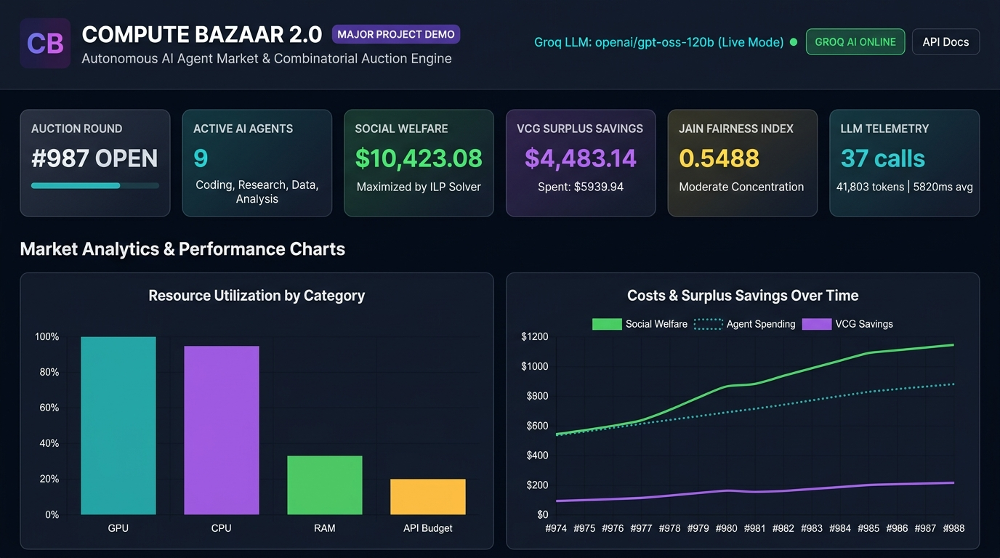
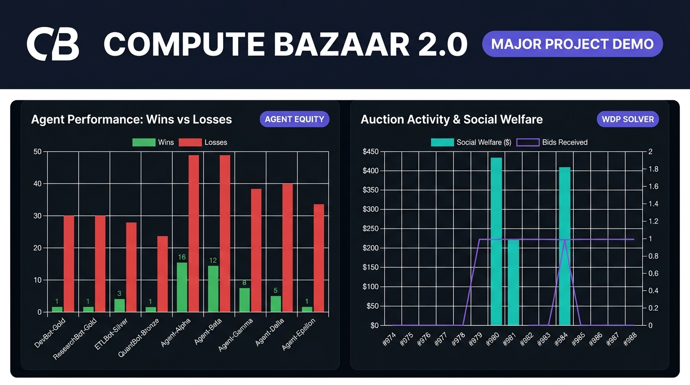
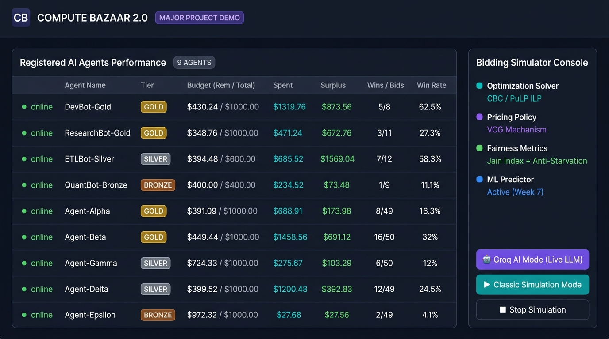
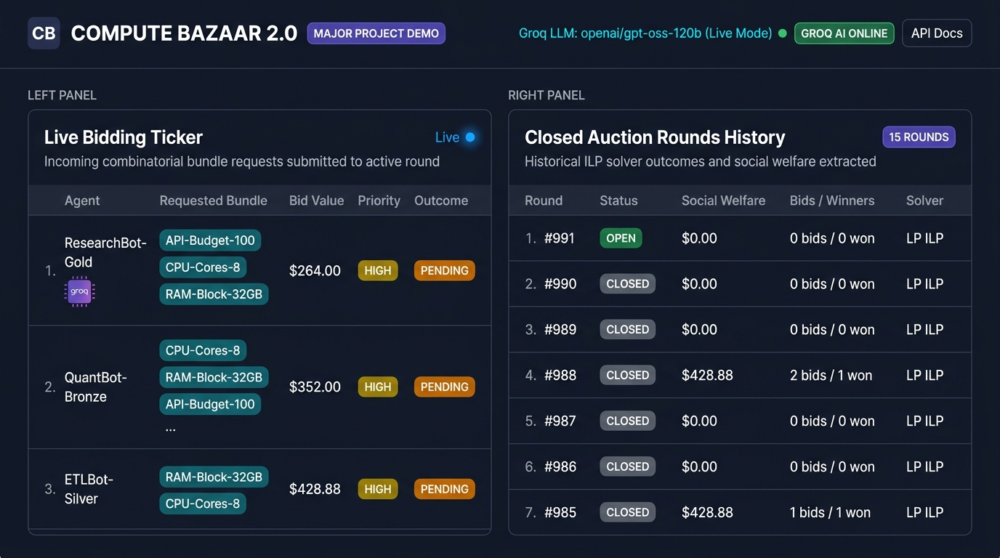

# Compute Bazaar 2.0: Autonomous Multi-Agent Combinatorial Compute Market

[](https://github.com/MuzraFatima/Compute-bazar/actions/workflows/ci.yml)
[](https://www.python.org/downloads/)
[](https://fastapi.tiangolo.com)
[](https://github.com/coin-or/pulp)
[](LICENSE)

An autonomous, market-driven compute allocation platform engineered for multi-agent artificial intelligence workloads. Compute Bazaar 2.0 formulates heterogeneous resource allocation as a **Combinatorial Winner Determination Problem (WDP)** solved via **Binary Integer Linear Programming (ILP)** with **Vickrey-Clarke-Groves (VCG) externality pricing**.

Autonomous AI agents powered by **Groq LLM reasoning**, cognitive memory (`AgentMemory`), machine learning resource forecasting (`ResourcePredictor`), and market anti-starvation guards (`FairnessTracker`) bid truthfully on atomic resource bundles (GPUs, TPUs, API budgets, RAM, CPU cores) without suffering from the exposure problem or queue-based blocking.

---

## Table of Contents

- [Dashboard (local)](#dashboard-local)
- [Overview](#overview)
- [Problem Statement](#problem-statement)
- [System Architecture](#system-architecture)
- [Core Features](#core-features)
  - [1. 4 Autonomous AI Agent Classes](#1-4-autonomous-ai-agent-classes)
  - [2. Groq LLM Cognitive Reasoning Layer](#2-groq-llm-cognitive-reasoning-layer)
  - [3. Combinatorial Auction & ILP Solver](#3-combinatorial-auction--ilp-solver)
  - [4. VCG Clarke Pivot Pricing & Tier Discounts](#4-vcg-clarke-pivot-pricing--tier-discounts)
  - [5. Intelligent & Adaptive Bidding](#5-intelligent--adaptive-bidding)
  - [6. Dynamic Marketplace & Scarcity Pricing](#6-dynamic-marketplace--scarcity-pricing)
  - [7. Cognitive Agent Memory & Jain Fairness](#7-cognitive-agent-memory--jain-fairness)
  - [8. ML Resource Prediction & Safe Toolset](#8-ml-resource-prediction--safe-toolset)
  - [9. Background Simulation Loop](#9-background-simulation-loop)
  - [10. Real-Time Glassmorphism Dashboard](#10-real-time-glassmorphism-dashboard)
- [Empirical Benchmark Results](#empirical-benchmark-results)
- [Predictor Accuracy](#predictor-accuracy)
- [Project Structure](#project-structure)
- [Installation & Quickstart](#installation--quickstart)
- [Docker](#docker)
- [Security Notes](#security-notes)
- [Authentication](#authentication)
- [Example Workflow](#example-workflow)
- [Examples & Scripts](#examples--scripts)
- [Running Tests](#running-tests)
- [Documentation](#documentation)
- [Limitations](#limitations)
- [Future Scope](#future-scope)
- [License](#license)

---

## Dashboard (local)

> The dashboard runs locally at `http://localhost:8000` after starting the FastAPI server. It live-streams auction rounds via WebSocket, renders real-time Chart.js analytics, and supports both **Groq AI Mode** (live LLM reasoning) and **Classic Simulation Mode** (offline agents).

### 🖥️ Dashboard Hero — Live Market Metrics



*Real-time header showing Auction Round #987, 9 Active AI Agents, $10,423.08 Social Welfare (maximized by ILP solver), $4,483.14 VCG Surplus Savings, 0.5488 Jain Fairness Index, and 37 Groq LLM calls with 41,803 tokens. Below: Resource Utilization by Category (GPU/CPU/RAM/API Budget) and Costs & Surplus Savings Over Time trend lines.*

---

### 📊 Market Analytics — Agent Performance Charts



*Left: **Agent Performance: Wins vs Losses** — grouped bar chart showing allocation equity across all 9 agents (DevBot-Gold through Agent-Epsilon), with win/loss outcomes tracked per auction round. Right: **Auction Activity & Social Welfare** — combined bar+line chart showing LP ILP solver welfare extraction per round vs. bid arrival count.*

---

### 🤖 Registered AI Agents — Live Leaderboard & Simulator Console



*Full agent leaderboard with real-time budget tracking, VCG surplus savings, tier rankings (Gold/Silver/Bronze), and win rates. Alongside: **Bidding Simulator Console** showing the active solver configuration (CBC / PuLP ILP), pricing policy (VCG Mechanism), and fairness controls (Jain Index + Anti-Starvation). Supports one-click switching between **Groq AI Mode** and **Classic Simulation Mode**.*

---

### ⚡ Live Bidding Ticker & Closed Auction Rounds History



*Left: **Live Bidding Ticker** — real-time WebSocket feed of incoming combinatorial bundle bids (ResearchBot-Gold, QuantBot-Bronze, ETLBot-Silver submitting `API-Budget-100 + CPU-Cores-8 + RAM-Block-32GB` bundles at HIGH priority, PENDING settlement). Right: **Closed Auction Rounds History** — historical ILP solver outcomes per round showing status, social welfare extracted, bid/winner counts, and solver type (LP ILP).*

---

## Overview

Modern machine learning workloads are inherently heterogeneous and co-dependent: training foundation models, executing distributed ETL pipelines, and running Monte Carlo simulations require synchronized bundles of GPU acceleration, high-capacity RAM, CPU cores, and external LLM API tokens.

Traditional schedulers treat resources as isolated silos or dispatch jobs via value-agnostic queues (First-Come First-Served or Round-Robin). Compute Bazaar 2.0 models compute allocation as an expressively combinatorial market:

1. **Agents express bundle requirements atomically**: Bids succeed or fail as complete packages ($S_i \subseteq R$), preventing stranded partial allocations (the exposure problem).
2. **Global welfare is maximized**: A binary integer program maximizes system value subject to physical capacity limits.
3. **Truthfulness is economically enforced**: VCG Clarke pivot pricing charges winners only the opportunity cost (externality) imposed on competitors, making truthful bidding a dominant strategy.
4. **Autonomous operation**: AI agents independently assess natural language task prompts, forecast hardware needs using regression models, construct bids, and adapt bidding strategies based on memory and market fairness telemetry.

---

## Problem Statement

Traditional cloud scheduling and spot resource mechanisms exhibit four major flaws:

1. **The Exposure Problem**: Standard spot markets auction compute units independently. An agent needing 2 GPUs and 32GB RAM might win only the RAM, paying for resources it cannot utilize.
2. **Head-of-Line Blocking**: In First-Come, First-Served (FCFS) schedulers (e.g., Slurm, default Kubernetes), an early low-priority batch script blocks high-value, latency-sensitive inference workloads.
3. **Value Destruction in Round-Robin**: Turn-taking queues allocate resources equally across agents regardless of true utility, forfeiting up to 38% of potential social welfare.
4. **Tactical Bidding Overhead**: Pay-as-bid auctions force agents to shade bids speculatively, resulting in market deadweight loss and complex counter-agent modeling.

---

## System Architecture

```
                      ┌─────────────────────────────────────────┐
                      │      Autonomous Multi-Agent Layer       │
                      │  Coding, Research, Data, Analysis Bots  │
                      │  - Groq LLM Inference (Reasoning)       │
                      │  - Cognitive AgentMemory (Loss streaks) │
                      │  - ML ResourcePredictor (Forecasting)   │
                      │  - Safe ToolRegistry (Execution loops)  │
                      └────────────────────┬────────────────────┘
                                           │ Combinatorial Bids
                                           ▼
                      ┌─────────────────────────────────────────┐
                      │       FastAPI Gateway & Security        │
                      │  - Dual JWT / API Key Authentication    │
                      │  - Pydantic v2 Request Validation       │
                      │  - WebSockets Broadcast Feed            │
                      └──────────────┬───────────────────┬──────┘
                                     │                   │
                        ┌────────────┴─────┐       ┌─────┴────────────┐
                        ▼                  ▼       ▼                  ▼
              ┌──────────────────┐  ┌──────────────────────────────────┐
              │ SQLite / Postgre │  │       Auction Engine Core        │
              │ (SQLAlchemy ORM) │  │  - PuLP / CBC Binary ILP Solver  │
              │ Tables:          │  │  - VCG Clarke Pivot Pricing      │
              │ - agents         │  │  - Loyalty Tier Discounts        │
              │ - resources      │  │  - 10-Second Epoch Scheduler     │
              │ - auctions       │  │  - Background Simulation Worker  │
              │ - bids / allocs  │  │  - DynamicMarketplace Engine     │
              └──────────────────┘  └──────────────────┬───────────────┘
                                                       │ Live Events
                                                       ▼
                                    ┌──────────────────────────────────┐
                                    │    Glassmorphism Dashboard UI   │
                                    │  - Real-time Bid Ticker          │
                                    │  - Resource Heatmap & Gauges     │
                                    │  - Chart.js Allocation Analytics │
                                    └──────────────────────────────────┘
```

---

## Core Features

### 1. 4 Autonomous AI Agent Classes
Located in `compute_bazaar/agents/`, four domain-specialized agents subclass `BaseAgent`:
- **CodingAgent**: Specializes in code generation, model fine-tuning, and software compilation (`GPU-Slot-1`, `CPU-Cores-8`).
- **ResearchAgent**: Specializes in literature synthesis, arXiv search, and dense embedding retrieval (`API-Budget-100`, `RAM-Block-32GB`).
- **DataAgent**: Specializes in distributed ETL pipelines, Apache Spark batch jobs, and dataset cleaning (`RAM-Block-32GB`, `CPU-Cores-8`).
- **AnalysisAgent**: Specializes in quantitative option pricing, risk modeling, and Monte Carlo simulations (`GPU-Slot-2`, `CPU-Cores-8`).

### 2. Groq LLM Cognitive Reasoning Layer
Located in `compute_bazaar/llm/`:
- Integrates Groq's high-speed LPU inference engine (supporting `llama-3.3-70b-versatile`, `openai/gpt-oss-120b`).
- Agents pass natural language task descriptions to the LLM to dynamically generate task complexity valuations, priority tags, and resource requirement breakdowns.
- Built-in **Mock Mode** (`LLMConfig(mock_mode=True)`) enables 100% offline, deterministic testing with full token and latency telemetry tracking.

### 3. Combinatorial Auction & ILP Solver
Located in `backend/app/auction/engine.py`:
- Formulates the Winner Determination Problem (WDP) as a **Binary Integer Linear Program**:
  $$\max \sum_{i \in B} v_i \cdot x_i \quad \text{subject to} \quad \sum_{i: r \in S_i} x_i \leq 1 \quad \forall r \in R, \quad x_i \in \{0, 1\}$$
- Solved to mathematical optimality using the Coin-or Branch and Cut (`CBC`) solver via `PuLP`.
- Guarantees zero resource double-allocation while resolving multi-resource bundle clashes.

### 4. VCG Clarke Pivot Pricing & Tier Discounts
Located in `backend/app/auction/engine.py` and `pricing.py`:
- Computes the exact externality each winner imposes on the rest of the market:
  $$p_i = V^*(B \setminus \{b_i\}) - \left[V^*(B) - v_i\right]$$
- Guarantees **Dominant-Strategy Incentive Compatibility (DSIC)**: truthful valuation reporting is mathematically dominant under quasi-linear utility with no budget limits ($v_i = \text{true value}$).
- **Note**: Priority shading (0.5×–0.95×) and budget constraints are modelled for experiments and break strict DSIC truthfulness in practice.
- Incorporates configurable customer loyalty tier discounts on top of raw VCG prices: **Gold (10% off)**, **Silver (5% off)**, **Bronze (0% off)**.

### 5. Intelligent & Adaptive Bidding
Located in `compute_bazaar/agents/base.py`:
- **Truthful Bidding**: Default strategy aligned with VCG market efficiency.
- **Priority-Based Shading**: Supports strategic operational constraints: Critical ($0.95 \times v$), High ($0.85 \times v$), Normal ($0.70 \times v$), Low ($0.50 \times v$).
- **Adaptive Memory Feedback**: When agents suffer consecutive losses, bidding algorithms dynamically escalate aggressiveness toward historical resource clearing prices.

### 6. Dynamic Marketplace & Scarcity Pricing
Located in `compute_bazaar/marketplace/`:
- `DynamicMarketplace` aggregates multiple `ResourceProvider` instances.
- Tracks real-time resource demand ratios ($\text{Demand} / \text{Capacity}$).
- Dynamically scales reserve price floors during peak congestion while resetting to baseline rates when demand subsides.

### 7. Cognitive Agent Memory & Jain Fairness
Located in `compute_bazaar/agents/memory.py` and `compute_bazaar/fairness/`:
- **`AgentMemory`**: Tracks historical win rates over sliding windows, loss streaks, won resource bundles, and rolling clearing price records.
- **`jains_fairness_index`**: Evaluates system equity across participating agents:
  $$J(x) = \frac{\left(\sum_{i=1}^n x_i\right)^2}{n \sum_{i=1}^n x_i^2} \in \left[\frac{1}{n}, 1.0\right]$$
- **`FairnessTracker`**: Calculates normalized starvation risk scores ($S_r \in [0, 1]$), detects resource domination (>65% win rates), and recommends priority boosts for starved participants.

### 8. ML Resource Prediction & Safe Toolset
Located in `compute_bazaar/prediction/` and `compute_bazaar/tools/`:
- **`ResourcePredictor`**: Category-conditional regression model forecasting required GPU slots, CPU cores, RAM gigabytes, execution time, and dollar cost from task descriptions. Confidence improves from 0.75 (cold start, <3 records) toward 0.95 as execution records accumulate (see [Predictor Accuracy](#predictor-accuracy)).
- **`ToolRegistry`**: Provides safe execution primitives:
  - `check_resources`: Queries live capacity and dynamic reserve prices.
  - `check_budget`: Queries agent remaining budget, spend, and starvation state.
  - `estimate_cost`: Invokes `ResourcePredictor` for capacity forecasting.
  - `execute_task`: Safely executes tasks on awarded resources and feeds actual runtime metrics back into predictor and memory.

### 9. Background Simulation Loop
Located in `backend/app/auction/simulation.py`:
- Automated simulation worker generating realistic multi-agent bidding traffic across 5 diverse personas (ML-Adaptive, Truthful, Shading, Critical, Bargain).
- Supports runtime controls via REST API (`/api/v1/simulation/start`, `/stop`, `/status`).

### 10. Real-Time Glassmorphism Dashboard
Located in `backend/app/static/`:
- Modern dark-mode UI with glassmorphism styling.
- Live WebSocket event ticker streaming bid submissions, auction round transitions, and winner announcements.
- Interactive Chart.js analytics tracking social welfare comparisons, clearing price history, and resource utilization gauges.

---

## Empirical Benchmark Results

A comprehensive benchmark was conducted across **25 reproducible rounds** with fixed seed `SEED = 42`, evaluating **ILP + VCG** against four baseline schedulers (**Greedy-by-Value**, **Round-Robin**, **FCFS**, and **Random**) under the exact same multi-agent workload and resource environment.

> **Setup**: 8 agents (Agent-Alpha through Agent-Theta), 5 resources (GPU-Slot-1, GPU-Slot-2, API-Budget-100, RAM-Block-32GB, CPU-Cores-8).  
> Raw metrics are archived in [`results/benchmark_results.json`](results/benchmark_results.json); detailed analysis is documented in [`docs/benchmark.md`](docs/benchmark.md).  
> **Note**: Baselines (Greedy-Value, Round-Robin, FCFS, Random) use pay-as-bid pricing; their cost columns are not like-for-like with ILP+VCG (VCG pricing). Screenshots show 9 simulated dashboard agents — the benchmark uses 8.

### 25-Round Performance Comparison (Seed = 42)

| Performance Metric | ILP + VCG (Compute Bazaar 2.0) | Greedy-Value (Highest Bid First) | Round-Robin (Cyclic Priority) | FCFS (Queue-Based Arrival) | Random (Serial Dispatch) |
|:---|:---:|:---:|:---:|:---:|:---:|
| **Total Social Welfare ($)** | **$7,647.39** | $7,362.69 | $5,536.69 | $6,405.35 | $5,338.80 |
| **Mean Welfare / Round ($)** | **$305.90** | $294.51 | $221.47 | $256.21 | $213.55 |
| **Resource Utilization (%)** | **87.2%** | 80.8% | 80.8% | 80.0% | 76.8% |
| Jain's Fairness Index ($J$) | 0.6642 | 0.5326 | **0.9204** | 0.4179 | 0.7733 |
| Total Agent Cost / Payments ($) | $5,007.60 | $7,362.69 | $5,536.69 | $6,405.35 | $5,338.80 |
| **Agent VCG Surplus Savings ($)** | **$2,639.79 (34.5%)** | $0.00 (0.0%) | $0.00 (0.0%) | $0.00 (0.0%) | $0.00 (0.0%) |
| Total Winners Count | 56 | 50 | 59 | 58 | 53 |
| Average Clearing Price ($) | $89.42 | $147.25 | $93.84 | $110.44 | $100.73 |
| **Mean Solver Latency (ms)** | 272.16 ms | 0.033 ms | 0.054 ms | **0.017 ms** | 0.038 ms |

> **Trade-offs**: ILP+VCG gives the highest welfare and utilization but lower fairness (Jain 0.6642) than Round-Robin and Random, and ~127 ms solve time vs <0.04 ms.

### Multi-Seed Robustness (Seeds 1–10, 25 rounds each)

| Method | Welfare mean ± std ($) | Util mean ± std (%) | Jain mean ± std | Cost mean ± std ($) |
|:---|:---:|:---:|:---:|:---:|
| **ILP + VCG** | **$7,504.89 ± $295.92** | **85.60% ± 3.20%** | 0.6553 ± 0.0549 | $4,685.80 ± $258.45 |
| Greedy-Value | $7,071.72 ± $237.24 | 78.00% ± 3.07% | 0.5781 ± 0.0704 | $7,071.72 ± $237.24 |
| Round-Robin | $5,218.18 ± $341.11 | 71.60% ± 3.64% | **0.8386 ± 0.0708** | $5,218.18 ± $341.11 |
| FCFS | $5,966.69 ± $356.78 | 74.56% ± 3.95% | 0.3977 ± 0.0440 | $5,966.69 ± $356.78 |
| Random | $5,506.12 ± $309.92 | 75.52% ± 2.67% | 0.8021 ± 0.0525 | $5,506.12 ± $309.92 |

Raw per-seed data: [`results/multiseed_benchmark.json`](results/multiseed_benchmark.json)

### Key Findings
1. **Welfare Superiority**: ILP + VCG achieved **$7,647.39** in social welfare, outperforming Greedy-Value by **+3.87%**, Round-Robin by **+38.12%**, FCFS by **+19.39%**, and Random by **+43.24%**.
2. **Economic Surplus**: Under VCG pricing, winning agents received **$2,639.79 (34.5%)** in Clarke pivot price discounts relative to their truthful valuations. All pay-as-bid baselines extracted 100% of bids with zero agent surplus.
3. **FCFS Inequality**: FCFS suffered from severe head-of-line blocking ($J = 0.4179$), allowing early-arriving agents to monopolize capacity regardless of task value.
4. **Real-Time Latency**: The ILP solver resolved combinatorial bundle constraints and all counterfactual VCG subproblems in **~272 ms** on average, well within real-time thresholds for periodic cluster scheduling epochs (10s).

---

## Predictor Accuracy

`ResourcePredictor` uses category-conditional historical averaging (not a neural network). Evaluated on 50 held-out synthetic workloads (10 per category), trained on 50 synthetic tasks:

| Predicted Field | MAE | MAPE |
|:---|:---:|:---:|
| GPU slots | 0.0000 | 0.00% |
| CPU cores | 0.0000 | 0.00% |
| RAM (GB) | 0.0000 | 0.00% |
| Execution time (s) | 127.50 | 20.98% |
| Cost ($) | 9.79 | 21.04% |

GPU/CPU/RAM are predicted from hard-coded category templates (zero error by construction). Execution time and cost (which vary within category) have ~21% MAPE — expected for category-level averaging. Full evaluation data: [`docs/predictor_eval.json`](docs/predictor_eval.json).

---

## Project Structure

```
compute-bazaar/
├── .github/
│   └── workflows/
│       └── ci.yml               # GitHub Actions CI (Python 3.11 & 3.12)
├── backend/
│   ├── app/
│   │   ├── api/                 # FastAPI REST endpoints & WebSocket handlers
│   │   │   ├── auth.py          # JWT + API Key auth; startup check for SECRET_KEY
│   │   │   ├── endpoints.py     # /api/v1/ routes (bids, resources, agents, dashboard)
│   │   │   └── websocket.py     # Real-time WebSocket pub/sub connection manager
│   │   ├── auction/             # Optimization, pricing & simulation logic
│   │   │   ├── agent_simulation.py # Groq-powered autonomous simulation loop
│   │   │   ├── engine.py        # AuctionEngine, ILP solver (PuLP), VCG computation
│   │   │   ├── pricing.py       # Loyalty tier discounts & budget checking
│   │   │   ├── scheduler.py     # 10-second epoch background worker
│   │   │   └── simulation.py    # Multi-agent automated simulation loop
│   │   ├── db/                  # SQLAlchemy models & raw DB utilities
│   │   │   ├── database.py      # Low-level SQLite schema (Week 1 reference)
│   │   │   └── models.py        # Agent, Resource, Auction, Bid, Allocation tables
│   │   ├── models/
│   │   │   └── schemas.py       # Pydantic request/response schemas
│   │   ├── static/              # Glassmorphism HTML/JS Dashboard & vendored assets
│   │   │   ├── index.html       # Main dashboard layout
│   │   │   └── app.js           # WebSocket feed, chart rendering, UI controls
│   │   └── main.py              # FastAPI application entrypoint & lifespan
│   └── requirements.txt         # Backend Python package dependencies
├── compute_bazaar/              # Client SDK & Agent Intelligence Package
│   ├── agents/                  # Autonomous AI agent implementations
│   │   ├── base.py              # BaseAgent with adaptive bidding & tool loops
│   │   ├── coding.py            # CodingAgent (Software/Training)
│   │   ├── research.py          # ResearchAgent (Literature/Embeddings)
│   │   ├── data.py              # DataAgent (ETL/Spark)
│   │   ├── analysis.py          # AnalysisAgent (Quantitative/Monte Carlo)
│   │   └── memory.py            # Cognitive AgentMemory & BidOutcome tracking
│   ├── autobid/
│   │   └── strategies.py        # Auto-bidding strategy implementations
│   ├── client/
│   │   └── sdk.py               # Python client SDK
│   ├── fairness/                # Fairness metrics & anti-starvation
│   │   └── metrics.py           # Jain's index, starvation risk, FairnessTracker
│   ├── generators/
│   │   └── workload.py          # Synthetic workload generators
│   ├── llm/                     # Groq LLM integration layer
│   │   └── client.py            # GroqLLMClient, LLMConfig, telemetry tracking
│   ├── marketplace/             # Dynamic marketplace & provider registry
│   │   ├── manager.py           # DynamicMarketplace orchestrator
│   │   └── provider.py          # ResourceProvider & scarcity pricing
│   ├── models/
│   │   └── bundle.py            # Bundle data models
│   ├── prediction/              # Machine learning resource forecasting
│   │   └── predictor.py         # ResourcePredictor with feedback training loop
│   └── tools/                   # Safe toolset for agent operations
│       └── agent_tools.py       # check_resources, check_budget, estimate_cost, execute_task
├── docs/                        # Architecture guides, benchmarks & final report
│   ├── agents.md                # Autonomous agent design guide
│   ├── api-reference.md         # REST API reference
│   ├── architecture.md          # System architecture deep dive
│   ├── auction-theory.md        # Combinatorial auction theory notes
│   ├── baseline.md              # Baseline mechanism comparison
│   ├── benchmark.md             # Comprehensive empirical benchmark report
│   ├── current-architecture.md  # Living architecture document
│   ├── evaluation.md            # Evaluation methodology
│   ├── fairness-and-memory.md   # Fairness & memory system docs
│   ├── groq-integration.md      # Groq LLM integration guide
│   ├── marketplace.md           # Marketplace & pricing docs
│   ├── prediction-and-tools.md  # ML predictor & toolset docs
│   ├── predictor_eval.json      # Predictor accuracy evaluation (MAE/MAPE)
│   ├── report.md                # Week 13 18-section final project report
│   └── sdk-guide.md             # Client SDK usage guide
├── examples/                    # Demo scripts & usage examples
│   ├── week1_demo.py            # Week 1 demo (greedy auction basics)
│   ├── week2_benchmark.py       # Week 2 benchmark (LP vs greedy)
│   ├── baseline_benchmark.py    # Baseline mechanism comparison
│   ├── evaluation_suite.py      # Full evaluation suite
│   └── end_to_end_demo.py       # End-to-end agent simulation demo
├── results/                     # Raw benchmark datasets
│   ├── benchmark_results.json   # Seed=42, 25-round benchmark results
│   └── multiseed_benchmark.json # Seeds 1-10, mean ± std results
├── scripts/                     # Utility scripts
│   ├── evaluate_predictor.py    # Evaluate ResourcePredictor (MAE/MAPE)
│   ├── example_workflow_output.py # 3-bidder VCG example script
│   └── run_multiseed_benchmark.py # Multi-seed benchmark runner
├── tests/                       # Comprehensive automated test suite (148 tests)
│   ├── test_sdk_and_autobid.py  # SDK & autobid strategy tests
│   ├── test_week1_engine.py     # Week 1 greedy solver tests
│   ├── test_week2_engine.py     # Solver & VCG unit tests
│   ├── test_week2_llm.py        # LLM client tests
│   ├── test_week3_8.py          # Integration: REST API, JWT, bidding (8 tests)
│   ├── test_week3_agents.py     # Autonomous agent behavioral tests
│   ├── test_week4_bidding.py    # Combinatorial bidding tests
│   ├── test_week5_marketplace.py # Scarcity pricing tests
│   ├── test_week6_fairness_memory.py # Fairness tracker & memory tests
│   ├── test_week7_prediction_tools.py # ML predictor & tool tests
│   ├── test_week8a_dashboard.py # FastAPI dashboard & UI tests
│   ├── test_week8b_evaluation.py # Empirical evaluation tests
│   └── test_week11_live_integration.py # Live integration (excluded from CI)
├── benchmark.py                 # Reproducible 25-round benchmark script (SEED=42)
├── conftest.py                  # Pytest configuration & fixtures
├── docker-compose.yml           # Docker Compose service definition
├── Dockerfile                   # Container image definition
├── .env.example                 # Environment variable template
└── README.md                    # Project documentation
```

---

## Installation & Quickstart

### Prerequisites
- Python 3.10, 3.11, 3.12, or 3.13
- Git

### 1. Clone Repository & Setup Virtual Environment
```bash
git clone https://github.com/MuzraFatima/Compute-bazar.git
cd Compute-bazar

# Create and activate virtual environment
python -m venv venv
# On Linux/macOS:
source venv/bin/activate
# On Windows:
.\venv\Scripts\activate
```

### 2. Install Dependencies
```bash
pip install -r backend/requirements.txt
```

### 3. Environment Variables (Optional)
Copy the example configuration file:
```bash
cp .env.example .env
```
To enable live Groq LLM reasoning (offline mock mode is enabled by default for tests and benchmarks):
```env
GROQ_API_KEY=gsk_your_actual_groq_api_key_here
```

### 4. Run the FastAPI Application Server
```bash
uvicorn backend.app.main:app --reload
```
The server will initialize the SQLite database (`backend/compute_bazaar.db`), start the background auction scheduler loop (10-second epochs), and serve the dashboard:
- **Web Dashboard**: `http://localhost:8000`
- **Interactive Swagger API Docs**: `http://localhost:8000/docs`
- **WebSocket Feed**: `ws://localhost:8000/ws/auction-feed`

---

## Docker

```bash
docker compose up --build
```

The `docker-compose.yml` mounts only a `/app/data` volume for the SQLite database, so the container source code is not shadowed by the volume mount. The service is available at `http://localhost:8000`.

---

## Security Notes

- `backend/app/api/auth.py` raises a `ValueError` at startup if `SECRET_KEY` is unset and `DEBUG=false`, preventing silent deployment of the hardcoded development key in production.
- The server supports dual authentication: **Bearer JWT tokens** and **X-API-Key** header.
- In production, set strong values for `SECRET_KEY` and `JWT_SECRET_KEY` in your environment or `.env` file.

---

## Authentication

All protected endpoints require a JWT Bearer token or `X-API-Key` header. Use the following flow:

```bash
# 1. Register a new agent
curl -s -X POST http://localhost:8000/api/v1/agents/register \
  -H "Content-Type: application/json" \
  -d '{"name": "MyAgent", "tier": "gold"}' | python -m json.tool

# 2. Exchange API key for JWT token (copy api_key from step 1)
curl -s -X POST "http://localhost:8000/api/v1/auth/token?api_key=cb_YOUR_API_KEY" \
  | python -m json.tool

# 3. Submit a combinatorial bid using JWT Bearer token
curl -s -X POST http://localhost:8000/api/v1/bids/submit \
  -H "Authorization: Bearer YOUR_JWT_TOKEN" \
  -H "Content-Type: application/json" \
  -d '{"resource_bundle": ["GPU-Slot-1", "CPU-Cores-8"], "bid_amount": 95.0, "task_description": "Model training", "priority": "high"}' \
  | python -m json.tool

# Alternative: submit bid using API Key header directly
curl -s -X POST http://localhost:8000/api/v1/bids/submit \
  -H "X-API-Key: cb_YOUR_API_KEY" \
  -H "Content-Type: application/json" \
  -d '{"resource_bundle": ["GPU-Slot-1"], "bid_amount": 60.0}' \
  | python -m json.tool
```

---

## Example Workflow

The following Python snippet demonstrates how an autonomous agent inspects market conditions, uses machine learning to forecast resource needs, constructs a truthful combinatorial bid with 3 competing bidders (ensuring a non-zero VCG payment), submits it to the engine, and executes the awarded task.

```python
from compute_bazaar.agents import CodingAgent
from compute_bazaar.llm import GroqLLMClient, LLMConfig
from compute_bazaar.tools import estimate_cost, execute_task
from backend.app.auction.engine import AuctionEngine, Resource, Bid, SolverMethod

# 1. Initialize Infrastructure & Engine
resources = [
    Resource("GPU-Slot-1",    "gpu", 1.0,  "slot"),
    Resource("RAM-Block-32GB","ram", 32.0, "gb"),
    Resource("CPU-Cores-8",   "cpu", 8.0,  "cores"),
]
engine = AuctionEngine(resources, method=SolverMethod.LP)

# 2. Initialize Autonomous Agent with Groq LLM Reasoning (mock mode)
llm = GroqLLMClient(config=LLMConfig(mock_mode=True))
agent = CodingAgent("AutoDevBot", budget=500.0, llm_client=llm)

# 3. Agent checks market availability & forecasts task needs
task_prompt = "Fine-tune 7B parameter code completion model"
prediction = estimate_cost(task_prompt)
print(f"ML Forecast: {prediction.predicted_execution_time_sec}s runtime | ${prediction.predicted_cost:.2f} cost")

# 4. Three competing bids on overlapping resources — ensures VCG payment > $0
# AutoDevBot bids $145 for GPU+CPU; ResearchBot bids $60 (GPU-only);
# AnalysisBot bids $70 (CPU+RAM). ILP picks AutoDevBot ($145 > $130 combined).
# VCG payment = value without AutoDevBot ($60+$70=$130) - 0 = $130.
bid_a = Bid(bid_id="bid-A", agent_id="AutoDevBot",  resource_bundle=["GPU-Slot-1", "CPU-Cores-8"], bid_amount=145.0)
bid_b = Bid(bid_id="bid-B", agent_id="ResearchBot", resource_bundle=["GPU-Slot-1"],               bid_amount=60.0)
bid_c = Bid(bid_id="bid-C", agent_id="AnalysisBot", resource_bundle=["CPU-Cores-8", "RAM-Block-32GB"], bid_amount=70.0)

engine.submit_bid(bid_a)
engine.submit_bid(bid_b)
engine.submit_bid(bid_c)

# 5. Engine runs auction round (ILP solve + VCG externality pricing)
result = engine.run_auction(round_id=1)

# 6. Winner execution feedback loop
print(f"\nAuction Round #1 — Winners: {len(result.winning_bids)}")
for winner in result.winning_bids:
    vcg_payment = result.payments[winner.bid_id]
    surplus = winner.bid_amount - vcg_payment
    print(f"  Winner: {winner.agent_id} | Bundle: {winner.resource_bundle}")
    print(f"  Bid: ${winner.bid_amount:.2f} | VCG Payment: ${vcg_payment:.2f} | Surplus: ${surplus:.2f}")
    if winner.agent_id == "AutoDevBot":
        execute_task(agent, task_prompt, {"won": True, "payment": vcg_payment, "resources": winner.resource_bundle})
```

**Real output** (run `python scripts/example_workflow_output.py` to reproduce):
```
ML Forecast: 600.0s runtime | $45.00 cost

Auction Round #1 — Winners: 1
  Winner: AutoDevBot | Bundle: ['GPU-Slot-1', 'CPU-Cores-8']
  Bid: $145.00 | VCG Payment: $130.00 | Surplus: $15.00
```

---

## Examples & Scripts

| Script | Description |
|:---|:---|
| `examples/week1_demo.py` | Week 1: greedy auction basics, SQLite schema demo |
| `examples/week2_benchmark.py` | Week 2: LP vs greedy comparison |
| `examples/baseline_benchmark.py` | Baseline mechanism comparison |
| `examples/evaluation_suite.py` | Full evaluation suite across all mechanisms |
| `examples/end_to_end_demo.py` | End-to-end autonomous agent simulation |
| `benchmark.py` | Reproducible 25-round benchmark (root, `SEED=42`) |
| `scripts/run_multiseed_benchmark.py` | Multi-seed (1–10) benchmark with mean ± std |
| `scripts/evaluate_predictor.py` | ResourcePredictor MAE/MAPE evaluation |

---

## Running Tests

The test suite provides comprehensive verification across auction mathematics, VCG payments, multi-agent cognition, dynamic pricing, and API endpoints:

```bash
# Run all 148 automated tests (excluding live integration test)
python -m pytest tests/ --ignore=tests/test_week11_live_integration.py -q
```

**Last verified result** (`python -m pytest tests/ --ignore=tests/test_week11_live_integration.py -q`):
```
............................................................... [ 48%]
............................................................... [ 97%]
....                                                           [100%]
148 passed, 683 warnings in 11.97s
```

### Re-running the 25-Round Empirical Benchmark
To regenerate [`results/benchmark_results.json`](results/benchmark_results.json) and [`docs/benchmark.md`](docs/benchmark.md):
```bash
python benchmark.py
```

---

## Documentation

All documentation lives in the [`docs/`](docs/) directory:

| Document | Description |
|:---|:---|
| [`docs/agents.md`](docs/agents.md) | Autonomous agent design & behavioral specs |
| [`docs/api-reference.md`](docs/api-reference.md) | Complete REST API reference |
| [`docs/architecture.md`](docs/architecture.md) | System architecture deep dive |
| [`docs/auction-theory.md`](docs/auction-theory.md) | Combinatorial auction & VCG theory |
| [`docs/baseline.md`](docs/baseline.md) | Baseline mechanism comparison analysis |
| [`docs/benchmark.md`](docs/benchmark.md) | Empirical benchmark report (generated) |
| [`docs/current-architecture.md`](docs/current-architecture.md) | Living architecture document |
| [`docs/evaluation.md`](docs/evaluation.md) | Evaluation methodology |
| [`docs/evaluation_results.json`](docs/evaluation_results.json) | Full evaluation suite raw metrics (JSON) |
| [`docs/fairness-and-memory.md`](docs/fairness-and-memory.md) | Fairness metrics & cognitive memory |
| [`docs/groq-integration.md`](docs/groq-integration.md) | Groq LLM integration guide |
| [`docs/marketplace.md`](docs/marketplace.md) | Dynamic marketplace & scarcity pricing |
| [`docs/prediction-and-tools.md`](docs/prediction-and-tools.md) | ML predictor & tool registry docs |
| [`docs/predictor_eval.json`](docs/predictor_eval.json) | Predictor accuracy evaluation (MAE/MAPE) |
| [`docs/report.md`](docs/report.md) | Week 13 final project report |
| [`docs/sdk-guide.md`](docs/sdk-guide.md) | Client SDK usage guide |

---

## Limitations

- **Simulated agents and valuations**: All agents and their valuations are synthetically generated. No real AI workloads or GPU hardware is involved.
- **Small scale**: The benchmark uses 8 agents and 5 resource types. Performance at production scale (thousands of agents, hundreds of resource types) is untested.
- **Single node**: The system runs on a single server with SQLite. It does not support distributed or federated deployments.
- **No real GPU execution**: `execute_task` simulates task execution with randomized duration; no actual compute jobs are dispatched.
- **DSIC is approximated**: Priority bid shading (0.5×–0.95×) and budget constraints in experiments break strict truthfulness.

---

## Future Scope

1. **Scale tests**: Evaluate ILP solver performance under 1,000+ simultaneous bids and 50+ resource types.
2. **Ascending-clock auctions**: Implement iterative ascending-clock (iBundle / proxy) auctions to reduce valuation elicitation overhead for repeated bidders.
3. **Real cluster-trace workloads**: Replace synthetic agent valuations with traces from public datasets (e.g., Google cluster traces, Alibaba production traces).
4. **HiGHS solver integration**: Replace PuLP/CBC with HiGHS for faster branch-and-cut performance on large ILP instances.
5. **Multi-node federation**: Extend to multi-datacenter resource federation via distributed auction protocols.

---

## License

This project is licensed under the MIT License — see the [LICENSE](LICENSE) file for details.
